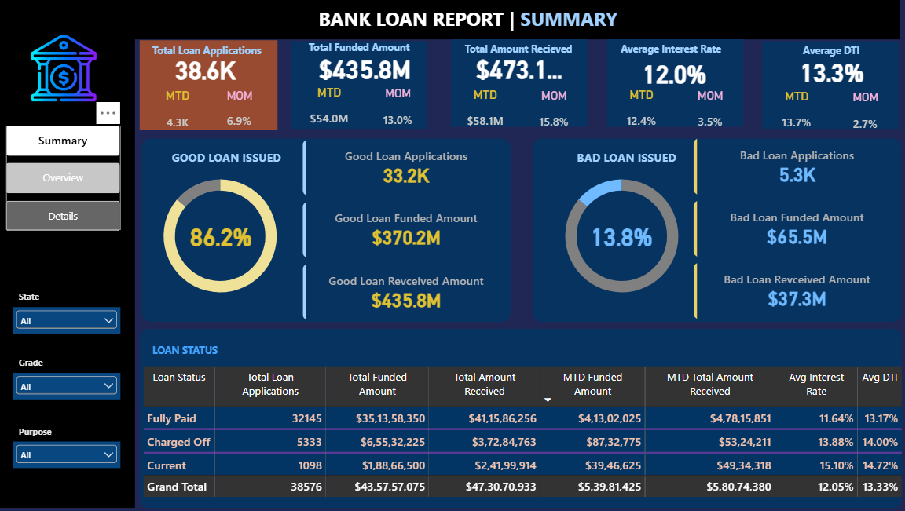
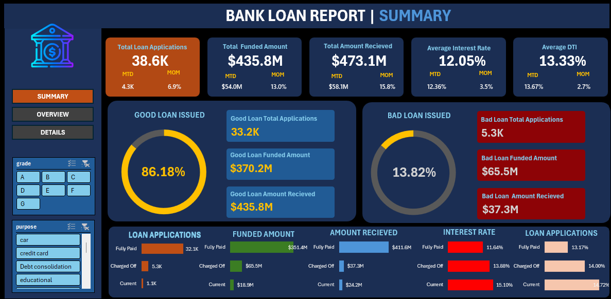
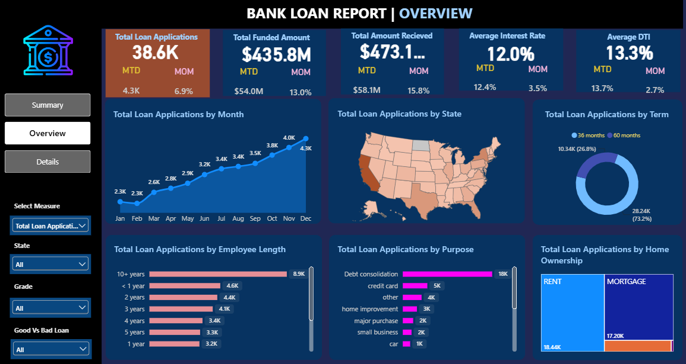
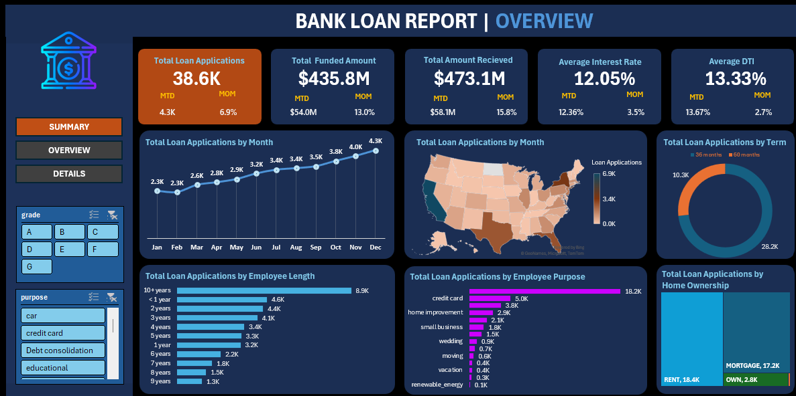
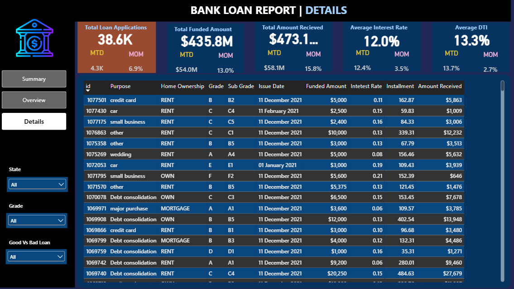

# Bank Loan Data Analysis

End-to-end Bank Loan Report to monitor and assess the bank's lending activities, loan portfolio health, and trends to support data-driven lending decisions.

Built using SQL, Python, Power BI, and Excel.

## Problem Statement
Create a comprehensive Bank Loan Report to track key loan metrics, distinguish Good Loans vs Bad Loans, and visualize trends by time, region, loan term, employment, purpose, and home ownership.

## Tools Used
- **SQL** - Data cleaning and analysis
- **Python** - Exploratory Data Analysis
- **Power BI** - Interactive Dashboards
- **Excel** - Dashboard and Reporting

## Dashboards

### Dashboard 1: SUMMARY
- Total Loan Applications, Total Funded Amount, Total Amount Received
- Average Interest Rate, Average Debt-to-Income Ratio (DTI)
- MTD values and Month-over-Month (MoM) changes
- Good Loan vs Bad Loan KPIs
- Loan Status Grid View

**Good Loan:** Loan Status = Fully Paid + Current
**Bad Loan:** Loan Status = Charged Off

### Dashboard 2: OVERVIEW
- Monthly Trends by Issue Date (Line Chart)
- Regional Analysis by State (Filled Map)
- Loan Term Analysis (Donut Chart)
- Employee Length Analysis (Bar Chart)
- Loan Purpose Breakdown (Bar Chart)
- Home Ownership Analysis (Tree Map)

### Dashboard 3: DETAILS
- Consolidated view of all essential loan data
- Detailed borrower profiles and loan performance
- One-stop view for loan portfolio details

## Project Structure
- `Bank-Loan-Analysis-SQL.sql` - SQL queries for analysis
- `Bank-Loan-Analysis-Python.ipynb` - Python EDA notebook
- `Bank-Loan-Analysis-PBI.pbix` - Power BI dashboard file
- `Bank-Loan-Analysis-Excel.xlsx.xlsx` - Excel dashboard file
- `Screenshots/PowerBI/` - Power BI dashboard screenshots
- `Screenshots/Excel/` - Excel dashboard screenshots

## Key Analysis Areas
- Loan Application Trends
- Good vs Bad Loans
- Loan Status Analysis
- Regional, Term, Purpose, Employment & Home Ownership Analysis

## Author
Shivamani Soma
